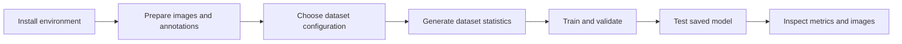
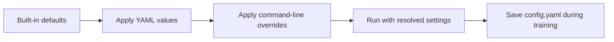
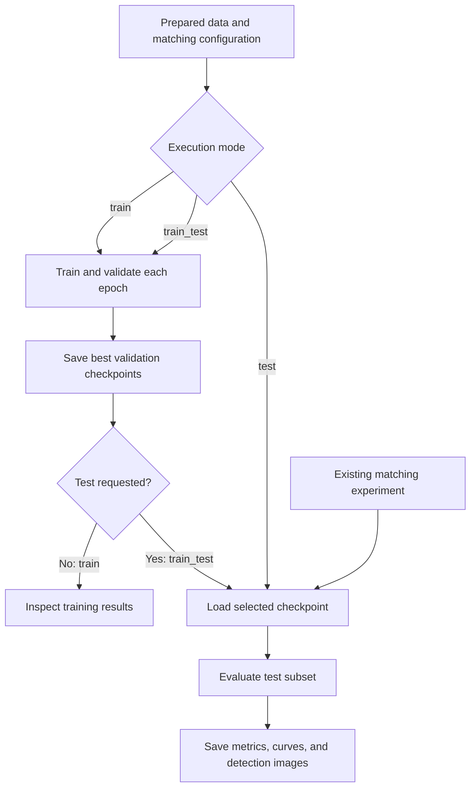
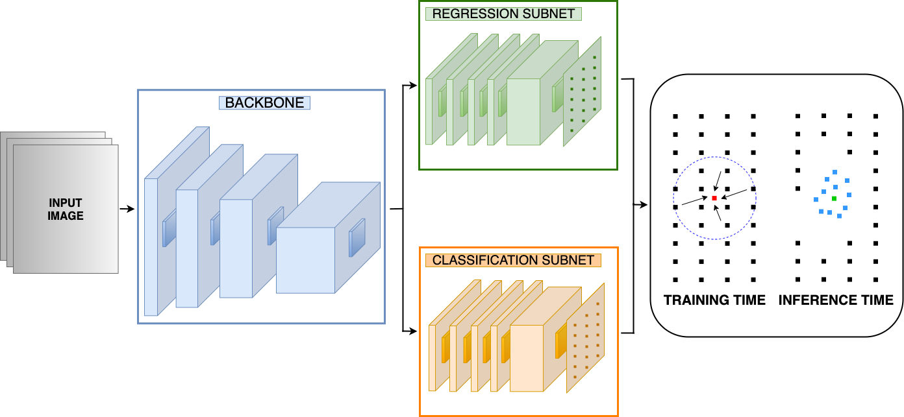

# GravityNet

GravityNet detects small lesions in medical images using **gravity points**: pixel-based anchors that move toward a lesion. It combines a feature-extraction backbone with classification and point-regression subnetworks.

This repository contains the training, evaluation, and visualization code. Start with the four steps below to run an experiment on your own prepared data.

[Quick start](#quick-start) · [Configuration](#configure-an-experiment) · [Train and test](#train-and-test) · [Docker and other installers](#other-installation-options) · [Troubleshooting](#troubleshooting) · [References](#references)



## Quick start

You need Python 3.10 or newer, [uv](https://docs.astral.sh/uv/), and access to the dataset you want to use. An NVIDIA GPU is useful for training; the launcher uses CUDA when available and otherwise runs on CPU. It does not currently select Apple MPS.

**The repository includes split files and statistics, but no source images or annotations.** Obtain and prepare those before launching an experiment. The presets describe datasets; they do not download or convert them.

Run all commands below from the repository root in a Bash/Zsh-compatible shell.

### 1. Install and check the environment

```bash
git clone https://github.com/cirorusso2910/GravityNet.git
cd GravityNet
uv sync --locked
source .venv/bin/activate
python GravityNet.py train_test --help
```

The last command lists the available options without starting training. Activate the environment again whenever you open a new terminal. With uv, you can also replace `python` with `uv run python`.

### 2. Prepare your dataset

For the INbreast example, place your prepared data under `datasets/INbreast/`:

```text
datasets/INbreast/
├── images/all/<name>.tiff
├── annotations/csv/all/<name>.csv
├── lists/normals.txt
├── split/split-1-fold.csv
└── statistics/rescale=1.0/
```

Each image needs an annotation CSV with `X,Y` columns. Split filenames and list entries use the image name **without its extension**. The default evaluation uses `lists/normals.txt`, listing images with no lesions, one name per line. See the [dataset preparation guide](datasets/dataset-structure.markdown) for examples, optional masks, and custom datasets.

### 3. Choose a configuration and generate statistics

Copy a preset so you can keep your experiment settings in one place:

```bash
cp configs/INbreast.yaml configs/my-experiment.yaml
mkdir -p experiments datasets/INbreast/statistics/rescale=1.0
```

Open `configs/my-experiment.yaml` and add these settings for a first run:

```yaml
dataset_path: datasets
experiments_path: experiments
epochs: 1
batch_size_train: 1
batch_size_val: 1
batch_size_test: 1
num_workers: 0
```

Then compute statistics from your prepared data:

```bash
PYTHONPATH=. python script-dataset/Dataset-Statistics.py script_dataset \
  --cfg configs/my-experiment.yaml
```

This writes `datasets/INbreast/statistics/rescale=1.0/split-1-fold-statistics.csv`. Generate it again whenever you change the data, split, or rescale factor. The bundled statistics are usable only if your prepared dataset matches them.

### 4. Train, test, and inspect results

```bash
python -u GravityNet.py train_test --cfg configs/my-experiment.yaml
```

This trains for one epoch, validates, loads the best saved checkpoint by validation sensitivity at 10 false positives per image, and evaluates the test subset. The first run checks your setup; increase `epochs` in your YAML for a longer experiment.

Results are written under `experiments/GravityNet_<generated-ID>/`:

| Folder or file | What to inspect |
| --- | --- |
| `config.yaml` | Snapshot of the resolved settings used for training |
| `models/` | Best model checkpoints (`.tar`) |
| `metrics-train/`, `metrics-test/` | Training/validation and test metrics as CSV |
| `plots-train/`, `plots-validation/`, `plots-test/` | Loss and evaluation curves |
| `detections/` | Validation and test detections |
| `output/output-test/` | Test images with drawn detections |

Keep your input YAML for subsequent commands. The generated `config.yaml` is an inspection snapshot and is not directly accepted by `--cfg`.

## Configure an experiment

Use a YAML file for the settings you want to keep and CLI flags for temporary overrides:

```bash
python GravityNet.py train_test --cfg configs/my-experiment.yaml --epochs 50
```



**Priority: CLI flags > YAML values > built-in defaults.** YAML keys match the names in [parameters_default.py](net/parameters/parameters_default.py); unknown keys cause an error. For example, use `batch_size_train` in YAML and `--batch_size_train` or `--bs` on the CLI. The loss weight uses the YAML key `lambda` and CLI flag `--lambda_factor`.

| Preset | Target | Bundled splits |
| --- | --- | --- |
| [INbreast](configs/INbreast.yaml) | Calcifications | `1-fold`, `2-fold` |
| [E-ophtha-MA](configs/E-ophtha-MA.yaml) | Microaneurysms | `1-fold`, `2-fold` |
| [Cervix93](configs/Cervix93.yaml) | Nuclei | `default` |

Presets override only a few dataset settings. Check your image extension, channel layout, split, and paths against your prepared files. See [all parameters](doc/code/parameters.markdown) and [available backbones](net/parameters/parameters_choices.py) for advanced options.

The two paths have different roles:

- `dataset_path` is the **parent** of the dataset folder: `dataset_path: /data` plus `dataset: INbreast` reads `/data/INbreast/`.
- `experiments_path` is the output root. Create it before training with `mkdir -p <your-output-root>`.

Boolean flags can be enabled with `--pretrained` or disabled with `--no-pretrained`; the same pattern applies to flags such as `--do_NMS` and `--clip_gradient`. In YAML, use `true` or `false`. Pretrained backbone weights are optional and may require a download.

### Keep runs separate and find checkpoints

GravityNet builds the experiment ID from selected settings, including dataset, split, rescale, normalization, epochs, learning rate, training batch size, backbone, gravity-point configuration, hook distance, evaluation criterion, and GPU label. **The ID does not include every setting**, so a new seed or another configuration change can still reuse the same output folder.

Use a different `experiments_path` for each independent run, for example `experiments/run-02`, and create that directory first. Training starts from epoch 1; it does not automatically resume an earlier run. Reusing a folder can overwrite results.

For a later test, keep the training YAML and its output root, including the original `epochs` and training batch size, so the generated ID still locates the checkpoint. The default separator is `_`; use `--sep '|'` only when accessing older folders created with that separator.

## Train and test

| Task | Command |
| --- | --- |
| Train and validate | `python GravityNet.py train --cfg configs/my-experiment.yaml` |
| Train, validate, then test | `python GravityNet.py train_test --cfg configs/my-experiment.yaml` |
| Test an existing experiment | `python GravityNet.py test --cfg configs/my-experiment.yaml` |

`test` requires a matching saved checkpoint and the prepared dataset, split, statistics, and evaluation list. It evaluates the annotated test subset; it is not a standalone command for predicting on an arbitrary image folder.



By default, testing loads the checkpoint with the best validation sensitivity at 10 false positives per image. To select AUFROC instead, disable the default selector and enable the alternative:

```bash
python GravityNet.py test --cfg configs/my-experiment.yaml \
  --no-load_best_sensitivity_10_FPS_model --load_best_AUFROC_0_10_model
```

### Optional analysis tools

These are separate script entry points; run them from the repository root with `PYTHONPATH=.`. Follow each guide for its command and prerequisites.

| Goal | Guide |
| --- | --- |
| Generate dataset statistics | [Dataset tools](script-dataset/script-dataset.markdown) |
| Visualize gravity points and hooking | [Anchor tools](script-anchors/script-anchors.markdown) |
| Inspect model explanations | [Grad-CAM](script-explainability/script-explainability.markdown) |
| Explore the architecture | [Model documentation](net/model/model.markdown) |



## Other installation options

Choose one environment manager. The quick-start commands use `python` from whichever environment you activate.

<details>
<summary>Conda or pip</summary>

With Conda:

```bash
conda env create -f environment.yml
conda activate gravitynet
```

With pip in a virtual environment:

```bash
python3 -m venv .venv
source .venv/bin/activate
python -m pip install -r requirements.txt
```

[pyproject.toml](pyproject.toml) defines the current dependencies; uv uses [uv.lock](uv.lock) for locked versions. The [legacy requirements](doc/requirements/requirements.markdown) describe the original paper environment.

</details>

<details>
<summary>Docker with an NVIDIA GPU</summary>

The supplied [Compose service](compose.yaml) requests an NVIDIA GPU and requires Docker Compose plus the NVIDIA Container Toolkit. It mounts `./datasets` and `./experiments` into `/app`. Prepare your dataset and configuration as above, using container-relative paths `datasets` and `experiments` in YAML.

```bash
mkdir -p experiments datasets/INbreast/statistics/rescale=1.0
docker compose build
docker compose run --rm --entrypoint python gravitynet \
  script-dataset/Dataset-Statistics.py script_dataset --cfg configs/my-experiment.yaml
docker compose run --rm gravitynet train_test --cfg configs/my-experiment.yaml
```

The image includes your configuration at build time. Rebuild after editing YAML or source code. Ensure the container user (UID 1000) can write to the mounted output and statistics directories.

</details>

<details>
<summary>PyPI library</summary>

The separately distributed [PyPI package](https://pypi.org/project/gravitynet/) can be installed with `pip install gravitynet` and imported with `import gravitynet`. The setup and launch commands in this README use this repository checkout and its scripts.

</details>

## Troubleshooting

| Symptom | What to check |
| --- | --- |
| Dataset or split file not found | `dataset_path` must point to the parent folder. Match `split` to `split-<value>.csv`; Cervix93 uses `default`. |
| Statistics file not found | Create `statistics/rescale=<value>/` and run the statistics script with the same dataset, split, and rescale settings. |
| Missing `normals.txt` or `all.txt` | Supply the list selected by `FP_images`; see the [dataset guide](datasets/dataset-structure.markdown). |
| Checkpoint not found in `test` | Train first, then reuse the original experiment settings, output root, and separator. |
| Out of memory | Reduce all three batch sizes. If you change `rescale`, regenerate statistics for that scale. |
| DataLoader worker errors | Start with `num_workers: 0`, as in the quick start. |
| `No module named net` in a helper script | Run from the repository root with `PYTHONPATH=.`. |
| Training runs on CPU | Check `python -c "import torch; print(torch.cuda.is_available())"`. The launcher selects CUDA only when PyTorch reports it available. |

## Authors and license

**GravityNet** official repository <br>
by **Eng. Ciro Russo, PhD** <br>
🔗 [LinkedIn](https://www.linkedin.com/in/ciro-russo-b14056100/) <br>
🎓 [Google Scholar](https://scholar.google.com/citations?user=XJV2vVsAAAAJ&hl=it&authuser=1) <br>
🧪 [Research Gate](https://www.researchgate.net/profile/Ciro-Russo-4/research) <br>
🧠 [Kaggle](https://www.kaggle.com/cirorusso2910) <br>

🏛️ **University of Cassino and Lazio Meridionale** <br>
👨‍🎓 Prof. **Claudio Marrocco** ([Google Scholar](https://scholar.google.it/citations?user=ed4B7I4AAAAJ&hl=it)) <br>
👨‍🎓 Prof. **Alessandro Bria** ([LinkedIn](https://www.linkedin.com/in/alessandro-bria-831ab149/?originalSubdomain=it))<br>
👨‍💻 Eng. **Giulio Russo** ([LinkedIn](https://www.linkedin.com/in/russogiulio/)) <br>


## References
**Paper**: [GravityNet for end-to-end small lesion detection](https://www.sciencedirect.com/science/article/abs/pii/S0933365724000848#preview-section-snippets) <br>
**ArXiv**: [GravityNet for end-to-end small lesion detection](https://arxiv.org/abs/2309.12876)

    @article{Russo_Bria_Marrocco_2024,
             author     =   {Russo, Ciro and Bria, Alessandro and Marrocco, Claudio},
             title      =   {GravityNet for end-to-end small lesion detection},
             journal    =   {Artificial Intelligence in Medicine}, 
             year       =   {2024},
             month      =   mar,
             pages      =   {102842}
             DOI        =   {10.1016/j.artmed.2024.102842}      
    }

**Paper**: [A Pixel-Based Anchor Approach for Nuclei Detection in Cervical Cytology Imaging](https://link.springer.com/chapter/10.1007/978-3-031-87660-8_20)

    @inproceedings{Russo_Tanriverdi_Bria_Marrocco_2025,
            author      =   {Russo, Ciro and Tanriverdi, Yusuf B. and Bria, Alessandro and Marrocco, Claudio},
            title       =   {A Pixel-Based Anchor Approach for Nuclei Detection in Cervical Cytology Imaging}, 
            booktitle   =   {Pattern Recognition. ICPR 2024 International Workshops and Challenges}, 
            publisher   =   {Springer Nature Switzerland}, 
            year        =   {2025}, 
            pages       =   {268–278},
            DOI         =   {10.1007/978-3-031-87660-8_20}
    }

**Paper**: [A Two-Stage Deep Learning Approach for Large Vessel Occlusion Detection and Volume Assessment](https://ieeexplore.ieee.org/document/11058806) 

    @inproceedings{Russo_Russo_Oliver_Lladó_Terceño_Silva_Bria_Marrocco_2025,
            author      =   {Russo, Ciro and Russo, Giulio and Oliver, Arnau and Lladó, Xavier and Terceño, Mikel and Silva, Yolanda and Bria, Alessandro and Marrocco, Claudio},
            title       =   {A Two-Stage Deep Learning Approach for Large Vessel Occlusion Detection and Volume Assessment},
            booktitle   =   {2025 IEEE 38th International Symposium on Computer-Based Medical Systems (CBMS)},
            publisher   =   {IEEE},
            year        =   {2025}, 
            pages       =   {813–818},
            DOI         =   {10.1109/cbms65348.2025.00166},
    }


This project is licensed. <br>
Please review the [LICENSE](LICENSE) file for more information.
