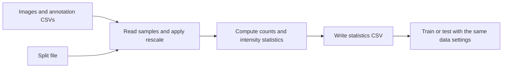

# Dataset statistics

Run this once after [preparing your data](../datasets/dataset-structure.markdown), then again whenever the data, annotations, split, or rescale factor changes. The training and test launcher reads these statistics even when normalization is disabled.

From the repository root, with your environment activated:

```bash
mkdir -p datasets/INbreast/statistics/rescale=1.0
PYTHONPATH=. python script-dataset/Dataset-Statistics.py script_dataset \
  --cfg configs/INbreast.yaml
```

Replace the preset with your own YAML if you changed paths or dataset settings. The `script_dataset` argument selects the helper's execution mode; the helper is launched through `Dataset-Statistics.py`.



The output path is:

```text
<dataset_path>/<dataset>/statistics/rescale=<rescale>/split-<split>-statistics.csv
```

Create its parent directory first. The script replaces the statistics file at that path. It reports image counts, normal-image counts, annotation counts, and minimum, maximum, mean, and standard deviation for the train, validation, and test subsets.

For example, to use half-size INbreast images:

```bash
mkdir -p datasets/INbreast/statistics/rescale=0.5
PYTHONPATH=. python script-dataset/Dataset-Statistics.py script_dataset \
  --cfg configs/INbreast.yaml --rescale 0.5
```

Set `rescale: 0.5` in your experiment YAML too, so training reads the matching file.

| Dataset | Bundled statistics |
| --- | --- |
| INbreast | [Statistics](../datasets/INbreast/statistics) |
| E-ophtha-MA | [Statistics](../datasets/E-ophtha-MA/statistics) |
| Cervix93 | [Statistics](../datasets/Cervix93/statistics) |

Use bundled statistics only when your data preparation and split match them.
